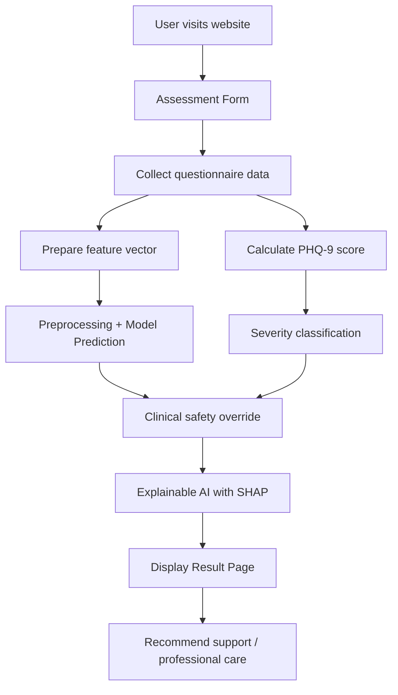

# Proposed System for MHDS

## 1. Project Analysis Summary

This project is a mental health support and prediction system built with Flask. The system gathers user responses through a web form, predicts whether the user may be experiencing mental health challenges, combines that with a PHQ-9 clinical screening result, and displays an explainable AI result page.

From the current application structure, the core parts are:

- Frontend pages built in HTML and Bootstrap
- Flask backend in app.py
- Pretrained ML model files in the models directory
- Survey dataset in survey.csv
- Static assets such as CSS, images, and GIFs

The current system already includes:

- Home page and onboarding flow
- Assessment form
- Model-based mental health prediction
- PHQ-9 severity scoring
- Clinical safety override when symptoms appear severe
- SHAP explanation chart
- Dataset analytics page
- Booking/contact step for follow-up

## 2. Current System Behavior

The application works in this flow:

1. User visits the home page.
2. User opens the assessment form.
3. The user enters demographic and workplace-related answers.
4. The backend converts the answers into a structured feature set.
5. A preprocessing transformer and saved ML model predict a treatment/no-treatment result.
6. The PHQ-9 score is calculated from answers 1 to 9.
7. The result is adjusted with a safety override if symptoms are clinically severe.
8. A SHAP visualization is generated to explain feature influence.
9. The result page presents the final recommendation.

## 3. Proposed System Architecture

### 3.1 Presentation Layer

This layer handles user interaction and displays all web pages.

- Home page
- Assessment form
- Result page
- Dataset analytics page
- Booking confirmation page

Technologies:

- HTML5
- Bootstrap 5
- CSS
- Flask templates

### 3.2 Application Layer

The Flask application acts as the main controller and orchestrator.

Responsibilities:

- Receive HTTP requests
- Validate form inputs
- Prepare input data for prediction
- Run the ML pipeline
- Calculate PHQ-9 severity
- Apply clinical safety logic
- Generate SHAP explanation plots
- Render result pages

Main module:

- app.py

### 3.3 ML and Analytics Layer

This layer handles prediction and explainability.

Components:

- Pretrained model object
- Categorical transformer for preprocessing
- Label encoder for classification output
- SHAP explainer for model interpretability
- PHQ-9 scoring logic

The saved model in this project is a scikit-learn ensemble boosting classifier, specifically the AdaBoost Classifier algorithm. It is not a neural network-based model. This is the AI decision engine for the system.

### 3.4 Data Layer

The system uses both structured survey data and ML artifacts.

Data sources:

- survey.csv for dataset analysis and statistics
- model.pkl for the trained classifier
- ct.pkl for the preprocessing transformer
- le.pkl for label decoding

### 3.5 Support and Safety Layer

This layer is important because the system is health-related.

Responsibilities:

- Detect severe symptom patterns using PHQ-9 thresholds
- Use clinical override to prioritize safety
- Show human guidance rather than automated diagnosis
- Encourage seeking professional care

## 4. Proposed System Flow

## 5. Functional Requirements

### User-facing functions

- Allow a user to complete a mental health assessment questionnaire.
- Accept demographic and workplace-related information.
- Provide a mental health prediction result.
- Show PHQ-9 score and severity level.
- Explain the prediction using SHAP visual output.
- Guide the user to seek help or a professional consultation.

### System functions

- Load ML model artifacts during application startup.
- Clean and transform incoming data for prediction.
- Run the prediction pipeline with consistent field mapping.
- Compare AI result with PHQ-9 risk threshold.
- Override to a safer output when symptoms indicate clinical concern.
- Present analytics from the survey dataset.

## 6. Non-Functional Requirements

- Fast response time for form submission
- Stable handling of missing or invalid input
- Clear, accessible UI for users
- Explainable output for trust and transparency
- Use of safe language for mental health guidance
- Ethical handling of health-related decisions

## 7. Key Strengths of the Current Project

- Clear and simple web-based workflow
- Uses real ML model inference
- Combines AI prediction with a clinically recognized risk tool
- Includes SHAP explainability
- Includes patient safety override logic
- Good presentation and user-friendly layout

## 8. Recommended Improvements for a Stronger Proposed System

1. Add authentication and user profile management for repeated assessments.
2. Store predictions in a database for tracking and monitoring.
3. Add role-based access for counselors or administrators.
4. Use a proper healthcare data governance model.
5. Add model validation and retraining pipeline.
6. Move the ML pipeline into a dedicated service or API.
7. Improve data validation and error handling for invalid values.
8. Add logging, audit trails, and security protections.
9. Add legal and ethical review for health-relevant decisions.
10. Consider integration with a real clinical or counseling system in production.

## 9. Final Proposed System Statement

The proposed system is a web-based mental health screening and support platform that combines questionnaire-based risk detection, PHQ-9 clinical assessment, explainable AI, and human-centered guidance. It is designed to help users understand potential mental health risk while encouraging professional support and safer decision-making. The system should be treated as a supportive screening tool, not a replacement for professional medical diagnosis.
